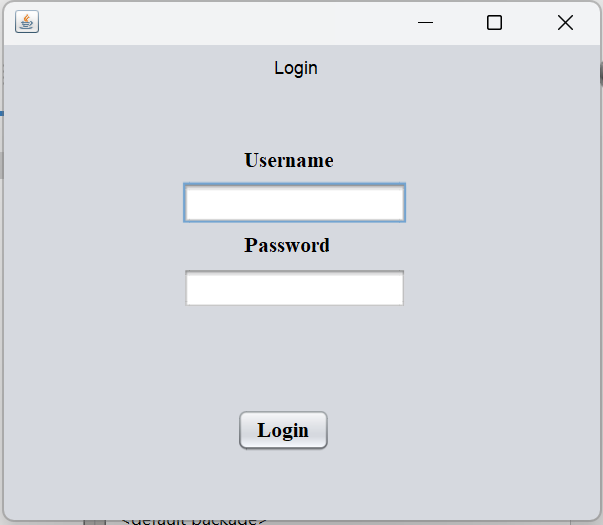
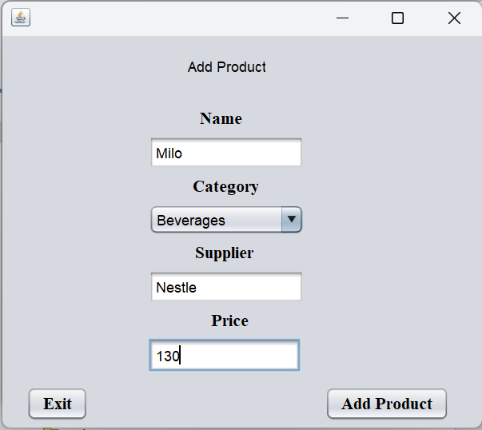
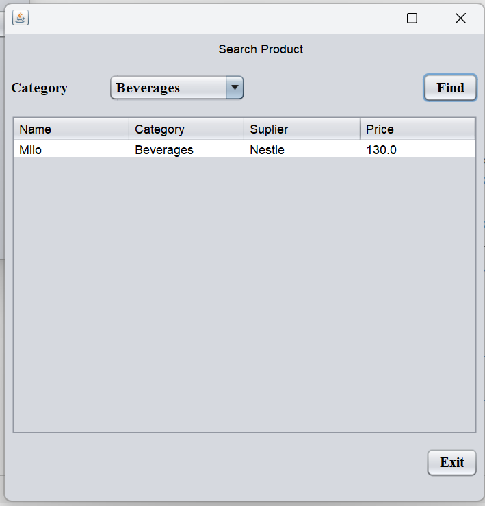

# TheGreenBasket — Java OOP Desktop Application

A **Java Swing GUI application** created for an **Object-Oriented Programming (OOP)** academic assignment. The project demonstrates a basic product and inventory workflow with a NetBeans form-based interface.

> **Classroom demonstration only.** This software uses local text-file persistence and basic, insecure demo authentication. It is not a production retail system.

## Desktop application screenshots

| Login | Add product |
| --- | --- |
|  |  |

*Actual historical Java Swing screens from the submitted coursework report.*

**Explore:** [Application structure](docs/ARCHITECTURE.md) · [OOP case study](docs/CASE_STUDY.md) · [Screenshot provenance](docs/SCREENSHOT_EVIDENCE.md)

## Functions found in source

- Login form and user creation
- Manager and sales assistant screens
- Add, view and search products
- Inventory display and file-based record handling

## Technologies

- Java 21, Java Swing and AWT
- Apache NetBeans GUI Builder (.form design files)
- Apache Ant project (build.xml)
- Text-file persistence for local demonstration

## Run

Recommended: Open the project in **Apache NetBeans** with JDK 21. The configured main class is **LoginForm**.

You can also compile directly:

~~~bash
mkdir -p out
javac -encoding UTF-8 -d out src/*.java
touch users.txt products.txt inventory.txt
java -cp out LoginForm
~~~

Run from the project root because relative paths are used for local files. The runtime records are deliberately excluded from version control; create fresh local data with the app.

## Security and scope limitations

The original academic exercise includes a hard-coded demo administrator login and stores additional user passwords in plain text files. It **must not be exposed as a real authentication system** or used with actual customer accounts. Storage lacks concurrent access safeguards, durable database guarantees and production backup handling.

This repository preserves the academic implementation and clearly discloses these limitations instead of claiming enterprise-grade features.

## Attribution

Individual OOP academic coursework curated for Kevin Menuja's engineering portfolio. Original academic reports, machine-specific NetBeans settings, build outputs and local user data are intentionally excluded.
