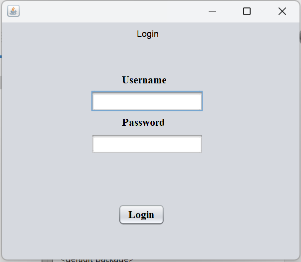
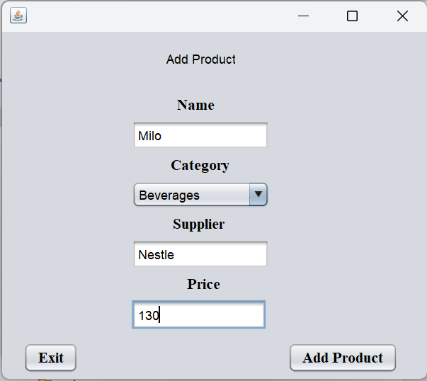
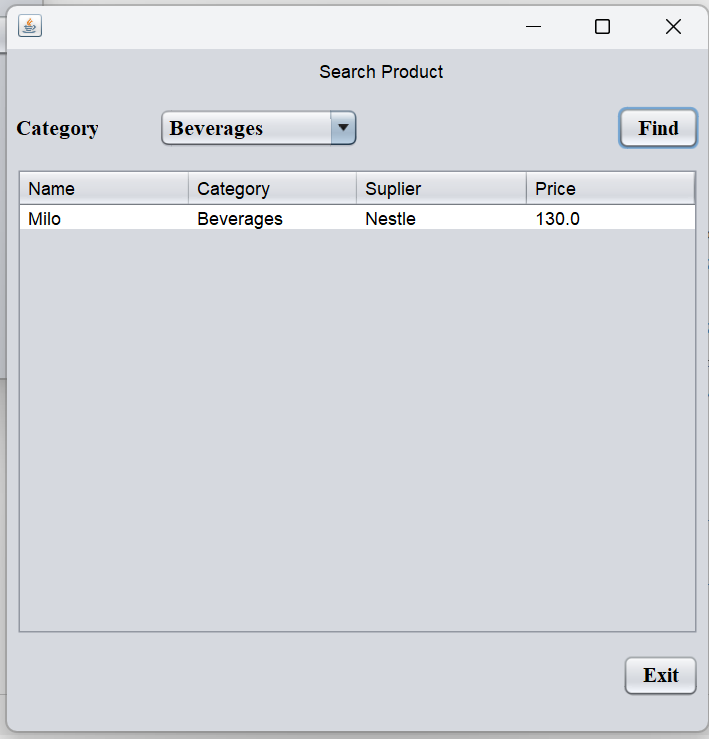

# Case study — TheGreenBasket grocery inventory desktop app

- **Project type:** Object-Oriented Programming academic assignment
- **Platform:** Java 21 / Swing desktop application
- **Tools:** Apache NetBeans GUI Builder and Ant project files
**Status:** Original coursework implementation, source verified by compilation

## The problem

The academic exercise models a small grocery operation where staff need to log in, add products, view available records, search a product category and inspect an inventory view. It also distinguishes the store-manager interface from the sales-assistant interface.

## What I can demonstrate from the code

- Nine Java source files and matching NetBeans GUI-form metadata.
- Local login with manager/sales-assistant navigation.
- Product creation and listing, category-based searching, and a manager-side user-creation screen.
- Local file storage used by the original code; no SQL or remote backend.

### Object-oriented design lessons

The Product class represents core product information, while Java Swing frame classes encapsulate the forms and action handlers. The implementation demonstrates classes, objects and GUI event programming. However, persistence, validation and view logic remain tightly coupled, creating a clear opportunity to discuss separation of concerns and more robust design.

## Verification

The prepared source compiled successfully with **Java 21** using javac, and the public GitHub Actions Java compilation workflow passed. No automated GUI or functional acceptance suite was found, so this case study **does not claim one**.

## Historical screenshots

| Login screen | Add product |
| --- | --- |
|  |  |

These are **actual interface screenshots from the submitted coursework PDF**, not recently executed screen captures. See [SCREENSHOT_EVIDENCE.md](SCREENSHOT_EVIDENCE.md).

## Issues and engineering reflection

- **Password security:** The original LoginForm accepts a classroom administrator credential, and CreateUserFrame writes plaintext user records. Do not use it with real accounts.
- **Persistence:** users.txt, products.txt and inventory.txt are intentionally excluded from GitHub because they represent mutable local data.
- **Concurrency and validation:** Flat-file writes require more robust error handling and locking for real use.
- **Maintainability:** A future iteration could introduce separate service and repository classes plus unit tests while preserving the visual UI.

The value of this project for a portfolio is the visible progression from basic object-oriented GUI programming toward more maintainable application architecture, without disguising its classroom limitations.

## Attribution

Prepared from Kevin Menuja's OOP coursework archive. Original academic reports and personal/local data are not included.
